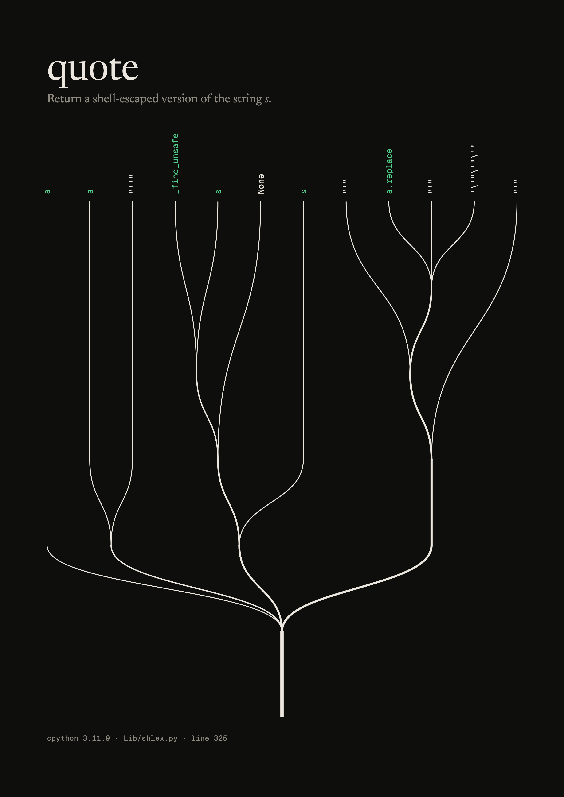

# canopy

canopy draws a Python function as a tree, the way Python itself reads it.

<p align="center">
  
</p>

Before Python runs a function, it parses the source into a syntax tree. canopy asks for that tree with the standard library's `ast` module and stands it upright. Names and values sit along the top as leaves, and the branches join into one trunk at the ground.

## How a poster is drawn

Every name, value, parameter and attribute (such as `s.replace`) becomes a leaf, placed left to right in the order it appears in the source. Names are green and values are white.

A parent sits over the middle of all the leaves it holds up, so the trunk always stands at the centre. Each level of the tree is one step down, and the leaves are lifted onto one line at the top.

Branch width follows Leonardo da Vinci's rule for trees: where a branch splits, the cross-sections of the parts add up to the branch's own, so width grows with the square root of the leaves above it. The trunk of `quote` holds 12 leaves.

The title is the function's name, the caption is the first line of its docstring, and the ground line says where the code lives. Each poster is 1200 by 1697 pixels, the shape of A-series paper.

## Run it

```bash
git clone https://github.com/laypatel13/canopy
cd canopy
python3 draw.py
```

That writes `poster.svg` for `shlex.quote`. canopy uses only the standard library and was written on Python 3.11.9. The SVG loads Newsreader and Geist Mono from Google Fonts when you open it in a browser; the PNG in `posters/` has them drawn in.

## What it does not do yet

It draws one function, `shlex.quote`; choosing the function from the command line comes next. Operators such as `+` and `not` shape the branches but get no leaf of their own.

## How it was built

I wrote canopy to learn how Python reads code, one small step at a time. The early steps are still here as they were written: `peek.py` prints the tree of one line, `leaves.py` walks it, `measure.py` finds each node's depth, `count.py` counts leaves and `layout.py` places them. `draw.py` makes the poster.

Along the way I learned a little about stacks, queues, breadth-first search and depth-first search. 😆
